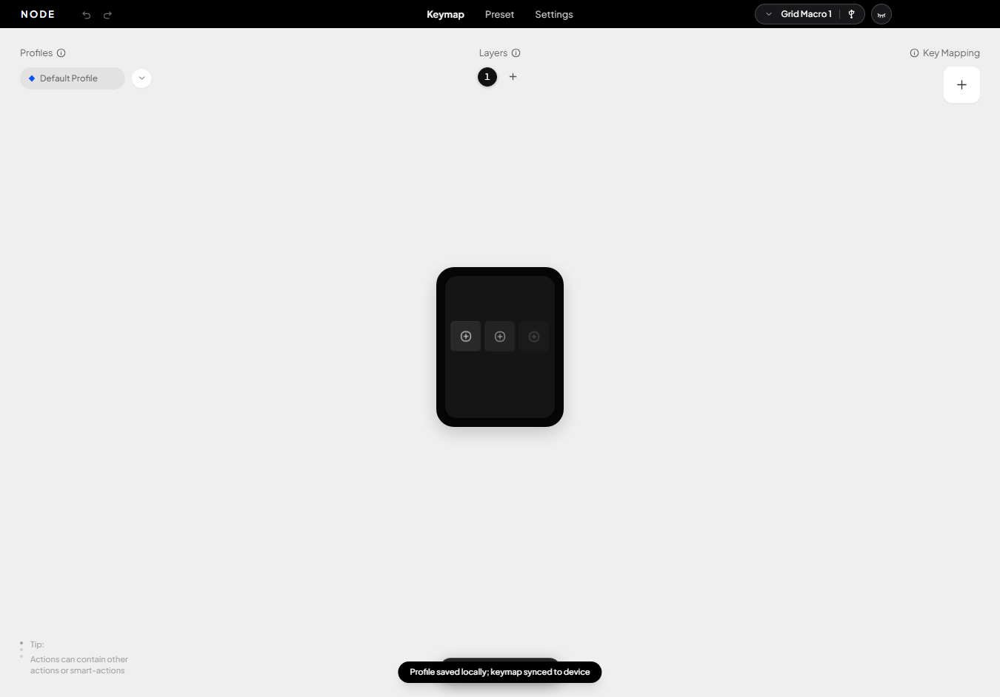

# NODE studio

[](https://github.com/david-8837/NODE/actions/workflows/ci.yml)

**A desktop studio for configuring the Grid Macro 1 macropad:** nine keys, one rotary encoder, profiles, presets, and custom actions.

[Download the latest Windows release](https://github.com/david-8837/NODE/releases/latest) · [Open the download site](https://david-8837.github.io/NODE/) · [Read the hardware checklist](HARDWARE_PREPARATION_CHECKLIST.md)



## What it does

- Create and organize profiles and keymap layers for the 3×3 keys and rotary encoder.
- Assign key combinations, media controls, layer actions, and custom Action, Multi-A, and Smart-A items.
- Start from workflow presets and customize them for your setup.
- Connect to supported QMK/VIA firmware over USB to read and synchronize supported key and encoder mappings.
- Import and export profile JSON files, and use the desktop app's native features such as installed-app discovery and firmware selection.
- Run host-assisted actions and an optional click-through Cheat Sheet overlay in the Windows desktop app. Terminal Smart Actions are disabled by default and require explicit opt-in.

Full profile descriptions and custom action definitions are stored in local browser/app storage; they do not automatically follow the device to another computer. The custom QMK firmware stores supported mappings and profile/layer state. Host-assisted actions and the Cheat Sheet require the desktop app to be running, although it can be minimized. Unsupported mappings are reported in the app.

## Download and platform support

The prebuilt desktop release currently targets **Windows x64** and includes:

- An assisted NSIS installer (`.exe`).
- A portable `.zip` package.

Use the [latest release page](https://github.com/david-8837/NODE/releases/latest) or the [download website](https://david-8837.github.io/NODE/); the website resolves the installer and ZIP from the latest published GitHub release. The Windows installer is currently **unsigned**, so Windows may show a security warning. Download it only from the official release page.

For browser-based device access, use a supported Chromium browser such as Chrome or Edge on `https://` or `localhost`, and grant USB/WebHID access from the app's Connect control. Native desktop actions, installed-app discovery, and firmware flashing are features of the Electron desktop app; availability can vary by operating system.

## Run from source

Requirements: **Node.js 22** and npm. Windows packaging also requires Rust and the Windows build toolchain.

```sh
git clone https://github.com/david-8837/NODE.git
cd NODE
npm ci
```

Run the browser development app:

```sh
npm run dev
```

Then open <http://localhost:5173/>. To start Vite and the Electron desktop shell together:

```sh
npm run desktop:dev
```

## Development checks

```sh
npm run lint          # TypeScript check
npm test               # Unit and integration tests
npm run build          # Production UI build
npm run check:bundle   # Enforce shipped JavaScript size budgets
bash qmk_firmware/tests/host/run.sh  # Host-compiled firmware behavior tests
```

`npm run build:win` builds the Windows installer and portable ZIP into `dist_electron/`; for a release-quality Windows package, use a Windows runner or the GitHub Actions packaging workflow. The repository CI also runs dependency auditing, firmware checks, and packaged-app smoke tests.

## Firmware

- [`qmk_firmware/grid_macro_1/`](qmk_firmware/grid_macro_1/) is the QMK/VIA keyboard-definition fragment used by the current HID configurator. It is **not** a complete QMK checkout. Its README explains the pinned build workflow and local build steps.

Before flashing a physical board, read the [hardware preparation checklist](HARDWARE_PREPARATION_CHECKLIST.md). CI compilation and automated protocol tests do not verify a board's wiring or electrical behavior; the current repository work has not validated a physical device. Confirm the board revision, pinout, USB identity, and recovery procedure against authoritative hardware documentation first.

## Repository map

| Path | Contents |
| --- | --- |
| `src/` | React/TypeScript configurator, profile logic, device protocol, and action handling |
| `electron/` | Desktop shell, Cheat Sheet, IPC bridge, action execution, and firmware validation |
| `native/rounded-blur/` | Windows Composition rounded backdrop source and license |
| `qmk_firmware/grid_macro_1/` | QMK/VIA keyboard definition and keymaps |
| `website/` | Public download landing page and latest-release link resolver |
| `windows-installer/` | Editable and compiled NSIS installer artwork |
| `tests/` | Unit, integration, UI, device-protocol, and installer-contract tests |

## Project documentation

- [Windows app and firmware guide](WINDOWS_APP_AND_FIRMWARE_GUIDE.md)
- [Hardware preparation and first-flash checklist](HARDWARE_PREPARATION_CHECKLIST.md)
- [Original product specification](docs/MICRO_PAD_MASTER_SPEC.md) (historical design baseline, not current implementation status)
- [QMK/VIA build and sync notes](qmk_firmware/grid_macro_1/README.md)

## License

This project is released under the [NODE Studio Source Available License](LICENSE). In short:

- ✅ **Free** to use, modify, and share for personal and non-commercial purposes.
- 📝 **Credit required** — you must attribute "NODE studio by david-8837" in any derivative work or product.
- 🚫 **No selling** without permission — commercial use, resale, or distribution for profit requires prior written approval from the author.
- 📬 **Commercial inquiries** — open an issue or reach out via the [GitHub repository](https://github.com/david-8837/NODE).
