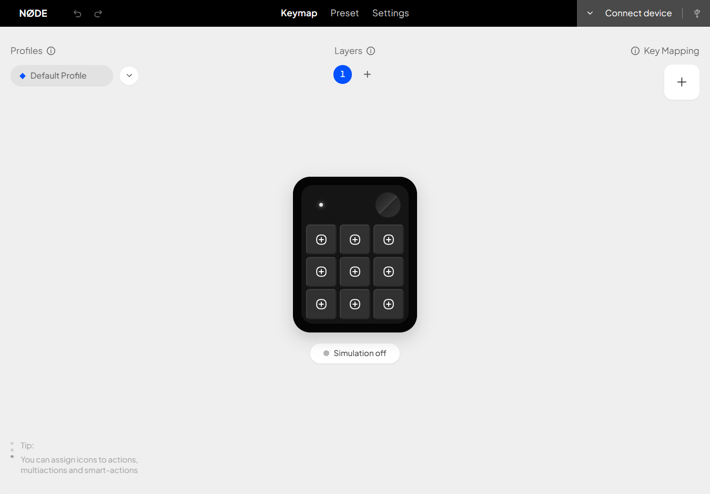

# NØDE Grid Macro 1 Studio

[](https://github.com/david-8837/NODE/actions/workflows/ci.yml)

**A desktop studio for configuring the NØDE Grid Macro 1 macropad:** nine keys, one rotary encoder, profiles, presets, and custom actions.

[Download the latest Windows release](https://github.com/david-8837/NODE/releases/latest) · [Open the download site](https://david-8837.github.io/NODE/) · [Read the hardware checklist](HARDWARE_PREPARATION_CHECKLIST.md)



## What it does

- Create and organize profiles and keymap layers for the 3×3 keys and rotary encoder.
- Assign key combinations, media controls, layer actions, and custom Action, Multi-A, and Smart-A items.
- Start from workflow presets and customize them for your setup.
- Connect to supported QMK/VIA firmware over USB to read and synchronize supported key and encoder mappings.
- Import and export profile JSON files, and use the desktop app's native features such as installed-app discovery and firmware selection.
- Use the Windows desktop app's optional simulation and Smart Action features. Terminal Smart Actions are disabled by default and require explicit opt-in.

The configurator keeps full profiles and custom actions in local browser/app storage; they are **not stored on the keyboard** and do not automatically follow the device to another browser or computer. Device synchronization supports standard VIA-compatible mappings; desktop-only or unsupported actions are not written to firmware and are reported in the app.

## Download and platform support

The prebuilt desktop release currently targets **Windows x64** and includes:

- An assisted NSIS installer (`.exe`).
- A portable `.zip` package.

Use the [latest release page](https://github.com/david-8837/NODE/releases/latest) or the [download website](https://david-8837.github.io/NODE/); the website resolves the installer and ZIP from the latest published GitHub release. The Windows installer is currently **unsigned**, so Windows may show a security warning. Download it only from the official release page.

For browser-based device access, use a supported Chromium browser such as Chrome or Edge on `https://` or `localhost`, and grant USB/WebHID access from the app's Connect control. Native desktop actions, installed-app discovery, and firmware flashing are features of the Electron desktop app; availability can vary by operating system.

## Run from source

Requirements: **Node.js 22** and npm.

```sh
git clone https://github.com/david-8837/NODE.git
cd NODE
npm ci
```

Run the browser development app:

```sh
npm run dev
```

Then open <http://localhost:5173/>. To start Vite and the Electron desktop shell together:

```sh
npm run desktop:dev
```

## Development checks

```sh
npm run lint          # TypeScript check
npm test               # Unit and integration tests
npm run test:phase1    # Phase 1 standalone background agent acceptance suite
npm run build          # Production UI build
npm run check:bundle   # Enforce shipped JavaScript size budgets
npm run test:stress    # Stress-test suite
```

Optional checks:

```sh
npm run audit:cpp      # Cppcheck firmware analysis; requires Cppcheck installed
npm run audit:mem      # Synthetic Node heap smoke check (not browser MemLab)
```

`npm run build:win` builds the Windows installer and portable ZIP into `dist_electron/`; for a release-quality Windows package, use a Windows runner or the GitHub Actions packaging workflow. The repository CI also runs dependency auditing, firmware checks, and packaged-app smoke tests.

## Firmware

- [`qmk_firmware/grid_macro_1/`](qmk_firmware/grid_macro_1/) is the QMK/VIA keyboard-definition fragment used by the current HID configurator. It is **not** a complete QMK checkout. Its README explains the pinned build workflow and local build steps.
- [`firmware/`](firmware/) contains CircuitPython and Arduino firmware sources. See its README for those alternatives.

Before flashing a physical board, read the [hardware preparation checklist](HARDWARE_PREPARATION_CHECKLIST.md). CI compilation and automated protocol tests do not verify a board's wiring or electrical behavior; the current repository work has not validated a physical device. Confirm the board revision, pinout, USB identity, and recovery procedure against authoritative hardware documentation first.

## Repository map

| Path | Contents |
| --- | --- |
| `src/` | React/TypeScript configurator, profile logic, device protocol, and action handling |
| `electron/` | Desktop shell, standalone background agent, process supervisor, safe IPC bridge, Windows action execution, and app discovery |
| `firmware/` | CircuitPython and Arduino firmware sources |
| `qmk_firmware/grid_macro_1/` | QMK/VIA keyboard definition and keymaps |
| `website/` | Public download landing page and latest-release link resolver |
| `windows-installer/` | Editable and compiled NSIS installer artwork |
| `tests/` | Unit, integration, UI, device-protocol, and installer-contract tests |
| `scripts/` | Bundle budget checks and Phase 1 background agent acceptance test runner |

## Phase 1 Background Agent

Phase 1 introduces an independent Windows background service process that maintains persistent HID communication with the Micro Pad even when NØDE Studio is closed:

- **Standalone Agent**: `electron/backgroundAgent.cjs` runs directly under Node.js 22 in interactive user sessions (Session 1+).
- **Process Supervisor**: `electron/agentSupervisor.cjs` launches and monitors the agent, enforces single-instance execution via local Named Pipe reservation, and applies crash-loop detection ($\ge 5$ crashes within 60s throttled to 30s restart backoff).
- **Exclusive HID Access**: Connects to the device (`VID: 0xFEED`, `PID: 0x6001`, `UsagePage: 0xFF60`, `Usage: 0x61`) via `node-hid`.
- **Local IPC**: Exposes `\\.\pipe\node-studio-ipc` using streaming JSON-line protocol with bi-directional handshake, status reporting, layer switching, profile synchronization with monotonic generation validation, and raw hardware event streaming.
- **Controlled Fallback**: NØDE Studio gracefully falls back to browser WebHID when the background agent is offline.

To run the background agent supervisor manually:

```sh
node electron/agentSupervisor.cjs
```

To run the full acceptance test suite:

```sh
npm run test:phase1
```

## Project documentation

- [Windows app and firmware guide](WINDOWS_APP_AND_FIRMWARE_GUIDE.md)
- [Hardware preparation and first-flash checklist](HARDWARE_PREPARATION_CHECKLIST.md)
- [Quality assessment (historical)](QUALITY_ASSESSMENT.md)
- [Quality improvement assessment (2026-11-12)](QUALITY_IMPROVEMENT_2026.md)
- [Firmware setup notes](firmware/README.md)
- [QMK/VIA build and sync notes](qmk_firmware/grid_macro_1/README.md)

## License

This project is licensed under the [GNU General Public License version 3.0 only](LICENSE) (GPL-3.0-only). Third-party components may have their own license terms.
