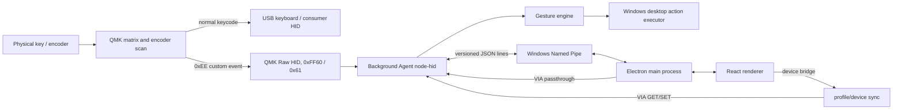
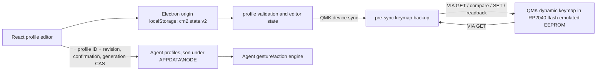

# NØDE Grid Macro 1 system architecture

## Scope and evidence

This map is based on repository source at the start of the reliability review. The repository contains a React/Vite configurator, an Electron shell, an independent Node Background Agent, a QMK/VIA keyboard-definition fragment, and separate CircuitPython firmware. The QMK folder is not a full QMK checkout. No physical device, schematic, or Windows HID diagnostic capture was available during this review.

## Runtime paths

### QMK/VIA device path

The QMK keymap reports every physical press/release and encoder event over Raw HID. It also returns `true` from `process_record_user` for ordinary keycodes, so firmware-stored keycodes can simultaneously emit keyboard/media actions. The default VIA layer is `KC_NO`; other compiled layers contain example mappings. Dynamic keymaps are persisted by QMK's VIA implementation, not by the desktop profile store.

### Profile and configuration path

The full profile, custom actions, layer labels, and lighting settings are stored in browser/app `localStorage`. The Agent separately loads `%APPDATA%\NODE\profiles.json`. Studio converts saved profiles to the Agent schema, compares a SHA-256 content revision and profile identity, asks before replacing a divergent Agent profile, and uses Agent generation as compare-and-swap. VIA stores supported key/encoder mappings only; it cannot hold full Smart Actions or Multi Actions. A third separate store exists in the CircuitPython alternative (`/keymap.json` on its CIRCUITPY filesystem), which is not the QMK transport.

## Communication boundaries and owners

| Boundary | Data | Owner / persistence |
| --- | --- | --- |
| Matrix/encoder → QMK | Physical events and keycodes | Firmware; dynamic keymap is VIA EEPROM emulation |
| QMK → Windows HID | Keyboard, consumer, and Raw HID reports | Agent is intended Raw HID owner; Windows owns keyboard/consumer collections |
| Agent ↔ Electron main | JSON-line messages on `\\.\pipe\node-studio-ipc` | Agent owns hardware/action execution; Electron main owns app IPC |
| Electron main ↔ React | Context-isolated `electronAPI` | Renderer edits and persists local profile |
| React → QMK/VIA | Supported key and encoder maps | Renderer initiates synchronization via device bridge; pre-sync snapshot and readback guard writes |
| CircuitPython ↔ host | USB HID plus CDC JSON | Separate firmware alternative, local `/keymap.json` |

## Findings at baseline

1. **Critical at baseline, fixed in this branch — HID interface selection was permissive.** It matched VID/PID and accepted a missing Usage Page without checking Usage ID `0x61`, risking selection of another composite-device collection. The Agent now requires the exact usage tuple and a path.
2. **Critical at baseline, fixed in this branch — Agent profile persistence could replace data after parse failure.** It logged corrupt JSON, created a minimal default, and wrote to the same path; empty/malformed profile entries were accepted. The Agent now preserves unreadable data, validates sync payloads, and backs up a valid prior file.
3. **High — Agent and Studio profile stores were not joined in code.** Studio now asks before replacing a divergent saved Agent profile and uses generation-checked synchronization. Windows session/reconnect execution still needs host validation.
4. **High — firmware and host assignments are independent.** VIA dynamic keymaps persist across Studio restarts and can emit normal HID keycodes while the Agent also handles the Raw HID event. Desktop-only actions require the Agent's synchronized profile; firmware keycodes can remain stale.
5. **High — synchronization state is split.** Studio has guarded VIA device-keymap reads, local snapshots, conflict prompts, and post-write verification. The Agent's JSON profile generation protects only its separate IPC store. It is not a device generation and is not a cross-store revision.
6. **Medium — Agent lifecycle is implicit.** HID errors immediately close the handle and polling retries every 1.5 seconds; connection status only reports a boolean. Sleep/resume, transient read errors, and reconnect state are not represented or tested against hardware.
7. **Medium — one OS HID interface owner is mostly established.** Electron Studio uses Agent VIA passthrough when connected, while browser WebHID is a fallback. The fallback/Agent transition and exact collection ownership need a real Windows trace to rule out overlap.

## Assignment execution model

| Assignment | Stored in | Execution | Studio closed / Agent unavailable |
| --- | --- | --- | --- |
| Basic keyboard key / chord | Studio local profile and QMK VIA dynamic keymap | Firmware emits standard keyboard HID; Agent observes custom event | Firmware still executes when device/PC are active |
| Media control | Studio profile and VIA dynamic keymap | Firmware consumer-control HID | Same as firmware key |
| Layer key | VIA dynamic keymap; UI profile reflects intended layer | Firmware switches QMK layer | Works in firmware if that layer/keycode is present |
| Smart Action | Studio profile mirrored to Agent after revision confirmation | Agent desktop action executor from gesture event | Requires valid Agent-side profile and active Windows session |
| Multi Action / gestures | Studio profile mirrored to Agent after revision confirmation | Agent gesture engine and executor | Requires Agent-side profile and active Windows session |
| Text, app, URL, command | Studio/Agent profile | Agent desktop executor subject to policy/consent | Requires Agent; command actions also follow stored settings |
| Encoder key/media mapping | Studio profile and VIA encoder map | Firmware encoder map | Firmware action continues independently |
| RGB settings | Studio local settings; volatile standard VIA RGBLIGHT for current QMK UI | Firmware LED controller | Volatile settings may reset on power cycle |
| CircuitPython actions | `/keymap.json` on board filesystem | CircuitPython HID/CDC loop | Separate firmware; not shared with QMK profile |

## Initial recovery policy

Do not infer a winner from arrival time. Preserve each store, read/validate it, report its identity/revision, and require an explicit compare-and-recover action for conflicts. The current application has a local unreadable-profile warning and QMK keymap snapshot/restore path, but no transaction that atomically joins Studio storage, Agent profile storage, and QMK device mappings. QMK VIA macro storage has a separate backup path and separate risk.

## Implementation phases

1. **Critical, source-only and low risk:** exact Raw HID collection filtering; reject empty/invalid Agent profiles; never replace unreadable persisted profiles; add targeted regression tests.
2. **High, desktop/Agent:** define and invoke a validated profile synchronization handshake with explicit IDs and revisions; expose Agent/device/profile sync states and retain stale-generation conflict behavior.
3. **High, integration:** make action ownership and firmware `KC_NO` behavior explicit for host-managed actions; verify Device keymap reads and readback; no automatic firmware flash.
4. **Medium, resilience:** model Agent/HID connection states, classify transient errors, back off reconnection, and exercise Agent restart and sleep/resume in simulated/Windows tests.
5. **Hardware validation:** record real interface paths, firmware ID/revision, device keymap/encoder map and VIA macro snapshots; validate unplug/replug, sleep/resume, actions, LEDs, and recovery with the user's board.

## Safety and limitations

The repository cannot reveal the live browser localStorage, `%APPDATA%\NODE\profiles.json`, connected firmware build, current physical keymap, VIA macro bytes, actual flash partitions, or board wiring. No backup of those live stores or physical configuration was possible from source inspection. Do not flash, erase, or change partition boundaries as part of these software phases. The firmware build notes identify a possible QMK VIA build-date reset and unverified binary checksum provenance; preserve independent backups before any future flash.
